# 🔬 RESEARCH: Agent-Main Memory Database Evaluation

> **Date**: 2026-03-03  
> **Scope**: Evaluate current database architecture, map feature dependencies, and recommend lighter/higher-performance alternatives  
> **Module**: `agent-main`

---

## 1. Current Architecture Overview

Agent-main uses a **two-layer hybrid database** architecture:

```mermaid
graph TB
    subgraph "Hot Path (In-Memory)"
        A[InMemoryStore] --> B[DashMap - logs]
        A --> C[DashMap - signatures]
        A --> D[DashMap - composite_index]
        A --> E[BTreeSet - unsynced_index]
        A --> F[HashMap - inflight_index]
        A --> G[BTreeSet - unpersisted_index]
    end
    
    subgraph "Cold Path (Disk)"
        H[SQLite via sqlx] --> I[zkt_raw_attendance]
        H --> J[devices]
        H --> K[agent_config]
        H --> L[zkt_failed_logs]
    end
    
    M[HybridDatabase] --> A
    M --> H
    
    style A fill:#2d5a27,stroke:#4ade80
    style H fill:#1e3a5f,stroke:#3b82f6
    style M fill:#5a2d27,stroke:#ef4444
```

### Layer 1: InMemoryStore (Hot Path)

| Component | Data Structure | Purpose |
|-----------|---------------|---------|
| `logs` | `DashMap<i64, MemoryLog>` | Primary attendance log storage |
| `signatures` | `DashMap<u64, i64>` | Dedup via FxHash signatures |
| `composite_index` | `DashMap<u64, i64>` | ACK correlation by composite key |
| `device_id_pool` | `DashMap<Arc<str>, Arc<str>>` | String interning for device IDs |
| `unsynced_index` | `RwLock<BTreeSet<i64>>` | FIFO ordering of unsynced logs |
| `unpersisted_index` | `RwLock<BTreeSet<i64>>` | Track what hasn't hit disk yet |
| `inflight_index` | `RwLock<HashMap<i64, Instant>>` | Timeout tracking for in-flight logs |

**Dependencies**: `dashmap` v6, `parking_lot` v0.12, `rustc-hash` v2

### Layer 2: SQLite (Cold Path)

| Table | Purpose |
|-------|---------|
| `zkt_raw_attendance` | Attendance logs (crash recovery + long-term) |
| `devices` | Device config (timezone, IP, active status, metadata) |
| `agent_config` | Key-value config store |
| `zkt_failed_logs` | Dead letter queue for expired logs |
| `parsing_errors` | Failed timestamp parse records |

**Configuration**: WAL mode, `busy_timeout=30s`, `cache_size=64MB`, `synchronous=NORMAL`

**Size**: 72KB on disk (lightweight), 12 migrations

---

## 2. Features Built on Current Architecture

### 2.1 Core Attendance Pipeline

| Feature | Layer | Description |
|---------|-------|-------------|
| Insert (single/batch) | Memory → Disk | Write to memory first, checkpoint to disk periodically |
| Dedup Signatures | Memory | FxHash of `(device_id, user_id, timestamp, punch, status)` |
| Signature TTL Eviction | Memory | Evict old signatures to bound memory |
| FIFO Sync Queue | Memory | BTreeSet-ordered unsynced retrieval |
| In-Flight Tracking | Memory | Track send-in-progress logs with timeout |
| Stale In-Flight Reset | Memory | Timeout-based reset of stuck in-flight logs |
| Composite Key ACK | Memory | Mark synced/reset by `device:user:ts:punch:status` key |
| Exponential Backoff | Memory | Skip retried logs during cooldown period |

### 2.2 Persistence & Recovery

| Feature | Layer | Description |
|---------|-------|-------------|
| Checkpoint | Memory → Disk | Flush unpersisted logs to SQLite |
| Crash Recovery | Disk → Memory | Reload unsynced/in-flight on startup |
| Flush All (Shutdown) | Memory → Disk | Final sync state persistence |
| Pending Sync Updates | Both | Queue status changes for batch disk update |

### 2.3 Device Management

| Feature | Layer | Description |
|---------|-------|-------------|
| Upsert Device | Disk | Add/update device config |
| Device Timezone | Disk | Local→UTC timestamp conversion |
| Device Metadata | Disk | MAC, serial, firmware, platform, capacity |
| Device Enable/Disable | Both | Load/unload signatures + logs per device |
| Deactivate Stale | Disk | Remove devices not in active list |

### 2.4 Maintenance

| Feature | Layer | Description |
|---------|-------|-------------|
| Cleanup Old Synced | Disk | Delete synced logs older than retention |
| Dead Letter Queue | Disk | Move expired/max-retry logs to `zkt_failed_logs` |
| Memory Compaction | Memory | `shrink_to_fit()` on DashMaps after eviction |

---

## 3. Evaluation of Current Architecture

### ✅ Strengths

1. **Sub-millisecond hot path**: DashMap reads/writes are ~50-200ns
2. **Lock-free reads**: DashMap provides concurrent read access
3. **Effective dedup**: FxHash signatures prevent duplicates efficiently
4. **Crash safety**: SQLite WAL ensures no data loss
5. **Small footprint**: 72KB disk, ~5MB for 10K logs in memory
6. **Well-tested**: ~80K lines of tests for memory store alone

### ⚠️ Weaknesses

1. **Triple storage overhead**: DashMap logs + signatures + composite_index (3 maps for same data)
2. **Index maintenance cost**: 5 separate indices (unsynced, unpersisted, inflight, signatures, composite) with manual sync
3. **Locking complexity**: `parking_lot::RwLock` on BTreeSet/HashMap blocks concurrent writes to index
4. **Memory fragmentation**: DashMap shard-based allocation can fragment heap under churn
5. **sqlx async overhead**: Full async runtime for simple SQLite ops adds unnecessary complexity
6. **Dual-write consistency**: Memory and disk states can diverge (pending_sync_updates queue)
7. **Index inconsistency risk**: Manual index bookkeeping across 5 data structures

### 📊 Memory Profile (estimated for 10K logs)

| Component | Size |
|-----------|------|
| DashMap logs (10K × ~400B) | ~4 MB |
| DashMap signatures (10K × 16B) | ~160 KB |
| DashMap composite_index (10K × 16B) | ~160 KB |
| BTreeSet × 2 (10K × 32B) | ~640 KB |
| HashMap inflight | ~128 KB |
| DashMap overhead (shards, metadata) | ~500 KB |
| **Total In-Memory** | **~5.6 MB** |
| SQLite (disk) | 72 KB |

---

## 4. Alternative Database Solutions

### 4.1 Redb (⭐ Recommended)

> Pure Rust, copy-on-write B+Tree, ACID, MVCC

| Aspect | Detail |
|--------|--------|
| **Architecture** | Copy-on-write B+Tree (like LMDB) |
| **Concurrency** | MVCC — non-blocking readers, single writer |
| **API** | `BTreeMap`-like with typed keys/values |
| **ACID** | Full ACID transactions |
| **Crash safety** | Copy-on-write ensures crash consistency |
| **Binary size** | Pure Rust, no C dependencies (~200KB) |
| **Memory** | Memory-mapped, OS manages cache |
| **Maturity** | Stable 1.0+ since 2023, actively maintained |

**Why it fits agent-main**:
- **Eliminates DashMap + BTreeSet + HashMap indices** → single B+Tree with range scans replaces all 5 indices
- **Zero-copy reads** → no `Clone` needed for `MemoryLog`
- **Built-in MVCC** → concurrent readers without locks
- **Replaces both layers** → single persistent store with memory-mapped performance
- **Range queries** → native ordered iteration replaces BTreeSet for FIFO

**Trade-offs**:
- Single writer (but agent-main's write pattern is already funnel-through-checkpoint)
- No SQL (but current code uses minimal SQL anyway)
- Need custom secondary indices (but simpler than current 5-index approach)

### 4.2 Fjall 3.0

> LSM-tree based, high write throughput, Rust-native

| Aspect | Detail |
|--------|--------|
| **Architecture** | LSM-tree (like RocksDB) |
| **Write throughput** | Very high (log-structured) |
| **Compression** | Built-in (LZ4/zlib) |
| **Read pattern** | Good but requires compaction |
| **Crash safety** | WAL + compaction |
| **Binary size** | Pure Rust, ~300KB |

**Why it could fit**:
- Excellent write throughput for log-heavy workload
- Good for append-heavy patterns (attendance logs)
- Built-in compression reduces disk usage

**Why NOT recommended**:
- LSM compaction adds background CPU/IO spikes
- Point lookups slower than B+Tree (bloom filters needed)
- More complex than needed for <100K records
- Write amplification not worth it at this scale

### 4.3 Sled

> BTreeMap-like API, lock-free, Rust-native

| Aspect | Detail |
|--------|--------|
| **Status** | ⚠️ Major rewrite in progress (v1.0) |
| **Architecture** | Lock-free Bw-tree |
| **API** | `BTreeMap<[u8], [u8]>` |

**Why NOT recommended**:
- Unstable — undergoing complete rewrite
- Current version has known durability issues
- `flush()` operations expensive
- Uncertain future API

### 4.4 Keep Current (Optimized)

> Optimize existing SQLite + DashMap without replacing

Possible optimizations:
- Merge `signatures` and `composite_index` into a single map
- Replace `BTreeSet<i64>` with `Vec<i64>` + sort-on-demand
- Use `scc::HashMap` instead of DashMap (lower overhead)
- Remove `parking_lot` RwLock — use DashMap for all indices

---

## 5. Recommendation Matrix

| Criteria | Current (SQLite+DashMap) | Redb | Fjall 3.0 | Sled |
|----------|------------------------|------|-----------|------|
| Read latency | ⭐⭐⭐⭐⭐ (in-memory) | ⭐⭐⭐⭐ (mmap) | ⭐⭐⭐ (LSM) | ⭐⭐⭐⭐ |
| Write latency | ⭐⭐⭐⭐ | ⭐⭐⭐⭐ | ⭐⭐⭐⭐⭐ | ⭐⭐⭐⭐ |
| Memory usage | ⭐⭐ (~5.6MB) | ⭐⭐⭐⭐ (OS-managed) | ⭐⭐⭐ | ⭐⭐⭐ |
| Crash safety | ⭐⭐⭐⭐ | ⭐⭐⭐⭐⭐ | ⭐⭐⭐⭐ | ⭐⭐ |
| Code complexity | ⭐⭐ (2200+ LOC) | ⭐⭐⭐⭐ (~800 LOC est.) | ⭐⭐⭐ | ⭐⭐⭐ |
| Dependencies | 4 crates | 1 crate | 1 crate | 1 crate |
| Maturity | ⭐⭐⭐⭐⭐ | ⭐⭐⭐⭐ | ⭐⭐⭐ | ⭐⭐ |
| Migration effort | N/A | Medium | Medium | Medium |

---

## 6. Final Recommendation

### 🏆 Primary: **Redb**

Redb is the best fit for agent-main because:

1. **Eliminates the entire InMemoryStore layer** (~628 LOC) — Redb's memory-mapped B+Tree provides in-memory speed with automatic disk persistence
2. **Removes 4 dependencies** (dashmap, parking_lot, rustc-hash → replaced by 1 redb)
3. **Simplifies architecture** from 2-layer hybrid (memory + disk + sync) to single-layer persistent store
4. **Built-in crash safety** via copy-on-write (no separate checkpoint/flush logic needed)
5. **Range queries** natively replace BTreeSet FIFO indices
6. **MVCC** replaces manual locking (parking_lot RwLock)
7. **Estimated code reduction**: ~1400 LOC eliminated (memory_store/ + checkpoint logic)

### 🥈 Secondary: **Keep current + optimize**

If migration risk is too high, optimize in-place:
- Merge redundant DashMaps
- Replace `parking_lot::RwLock<BTreeSet>` with `scc::TreeIndex`
- Add periodic memory compaction

---

## 7. Migration Risk Assessment

| Risk | Impact | Mitigation |
|------|--------|------------|
| Data migration from SQLite | Medium | Write one-time migration script |
| API surface change | High | Create adapter trait, implement for both backends |
| Test regression | Medium | Existing 80K+ test LOC provides safety net |
| Performance regression on hot path | Low | Redb mmap reads are comparable to DashMap |
| Loss of SQL flexibility | Low | Only simple queries used currently |
| Device management tables | Low | Keep SQLite for config, use Redb for attendance only |

> [!IMPORTANT]
> **Hybrid approach possible**: Use Redb for attendance logs (hot path) and keep SQLite for device config/agent_config (rarely accessed). This minimizes migration risk while capturing most performance gains.
